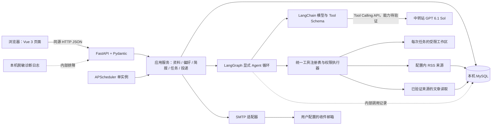
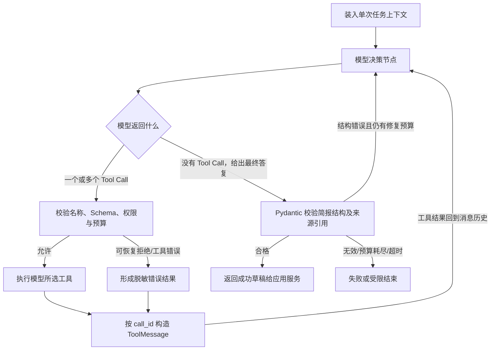

# 每日 AI 新闻助手 Agent：技术方案

本文把已确认的 MVP 产品设计、技术栈及当前交互 Demo 转化为实现方案。本文只定义边界和设计，不包含后端业务代码。所有未验证的供应商能力或运行环境均标为“待定”。

## 1. 范围与已确认决策

| 项目 | 决策 |
|---|---|
| 产品范围 | 本机单用户；填写个人资料与 AI 领域订阅偏好；每日生成中文简报；邮件推送；历史查看 |
| 关注方向 | 与当前 Demo 一致：AI 与学习教育、AI 与体育、AI 与日常生活、AI 与工作效率、AI 与创作、大模型与研究、Agent 与工具、开源项目、AI 工程、多模态、行业动态 |
| 默认简报 | 每天一次、中文、约 5 条；内容不足时不凑数 |
| 前端 | Vue 3 + Vite + JavaScript；当前 Demo 的每日简报、历史简报、身份与订阅三个页面作为交互参考 |
| API 服务 | Python + FastAPI + Pydantic |
| Agent | LangChain 模型与工具接口 + 显式 LangGraph 决策循环 |
| 数据库 | MySQL + SQLAlchemy + PyMySQL；服务器版本、字符集设置与连接参数待实测 |
| 新闻 | 有限、可信的 RSS 来源；按需读取来源文章；不接入第三方新闻搜索服务 |
| 邮件 | 本人收件地址 + SMTP；邮箱服务、凭据与 SMTP 能力待确认和验证 |
| 调度 | APScheduler；单个后端进程维护一个调度实例 |
| 测试 | Python pytest；现有 Demo 使用 Vitest |
| 模型 | 中转站的 GPT 6.1 Sol；实际模型标识、API 地址、Tool Calling 和并行调用能力待验证 |
| 预算 | 外部服务月预算目标为人民币 10 元；实际调用成本待试运行验证 |

第一阶段前端 Demo 使用虚构新闻、浏览器本地偏好和预设状态，不含 FastAPI、LangGraph、MySQL、RSS 或 SMTP。正式实现须将页面请求接到本机 API；Demo 里的工具轨迹不作为真实 Agent 行为依据。

不纳入 MVP：公开注册、复杂多用户权限、Redis、消息队列、微服务、多 Agent、向量数据库、独立 RAG、开放式长期记忆、用户画像和第三方新闻搜索 API。

## 2. 整体架构



FastAPI 与前端开发时可分别运行；Vite 将 `/api` 请求代理至 FastAPI。日常本机运行由 FastAPI 提供构建后的静态前端，以同源访问降低配置复杂度。生产仍只监听 `127.0.0.1`，不开放公网或局域网。

核心边界如下：

- **模型决策**：在可用工具中选择工具名与参数、决定下一步是否继续调用、决定何时以最终答复结束。工具选择不由后端固定为“获取 RSS → 搜索 → 摘要”的线性顺序。
- **程序安全约束**：后端校验调用身份、参数、路径、URL、命令、预算及超时；拦截越权输入、终止耗尽资源的任务。这些检查限制允许动作，不替模型决定新闻处理步骤。
- **工具执行**：按注册表执行一个被授权的具体动作并返回有界结果；执行器不自行串联下一项业务工作。
- **固定服务流程**：调度器创建任务；任务服务装载上下文；任务成功后校验及保存简报；邮件服务从已保存配置取得唯一收件人并投递。这些服务不交由模型决定。
- **用户可见信息**：当前产品页面展示简报、资料偏好和必要的生成/投递状态。Agent 工具轨迹不通过用户 API 或当前用户页面显示；它只作为脱敏的本机开发诊断记录。开发者仅能在显式启用的开发模式诊断面板查看有界摘要。

## 3. 模块边界

| 模块 | 技术 | 职责与依赖 |
|---|---|---|
| `frontend` | Vue 3、Vite、JavaScript | 保持 Demo 的三页信息结构；调用同源 API；显示任务状态、简报和投递结果；不接触模型或邮件凭据 |
| `api` | FastAPI、Pydantic | HTTP 输入校验、调用应用服务、输出用户可见 DTO；不直接执行 Shell 或操作 LLM |
| `application` | Python 服务层 | 管理资料、订阅、简报查询、任务生命周期、幂等和授权后的投递；协调数据库、Agent 与邮件端口 |
| `agent` | LangChain、LangGraph | 注入单次任务上下文；绑定注册工具；根据模型 Tool Call 动态执行循环；产生最终简报草稿及结束状态 |
| `tools` | 统一注册表、Pydantic Schema | 注册题目要求的五个工具和新闻获取工具；验证参数、权限、预算、输出大小；封装错误结果 |
| `news` | HTTPX、feedparser、Python HTML 解析器 | 读取配置内 RSS，规范条目及来源时间；按需读取获准原文；外部网络访问执行 URL 与响应限制 |
| `scheduler` | APScheduler | 根据保存的每日时间和时区触发任务；恢复启动后的当天待办；数据库唯一键防止并发重复 |
| `delivery` | Python `smtplib` / `email` | 使用本机服务配置发信；目标只能来自保存的个人资料；记录每次投递结果及重试状态 |
| `persistence` | SQLAlchemy、PyMySQL、MySQL | ORM、事务、迁移、索引及约束；不向 LLM 暴露原始凭据 |
| `observability` | Python `logging`、MySQL 运行记录 | 关联任务 ID，记录脱敏状态、错误类别、耗时和模型用量；不保存密钥或内部思维链 |

HTML 正文抽取依赖目前**待定**。初版可封装在文章读取适配器内，先用标准库提取必要文本；复杂页面无法可靠抽取时返回“文章不可读取”，不通过猜测补全文本。若试运行证明覆盖不足，再评估维护中的正文抽取依赖。

## 4. Agent 执行机制

### 4.1 任务上下文

应用服务创建 `task_run` 后读取并冻结本次订阅快照，向 Agent 提供：

- 任务目标、报告日期、允许的语言和目标条数。
- 脱敏的关注话题、关键词、排除关键词和内容新鲜度边界。
- RSS 来源目录：系统来源 ID、来源名称、受信主机、内容类别和状态；目录由程序配置，模型不能新增任意 URL。
- 本次工作区标识、工具列表、剩余时间及模型调用预算。
- 必须保留真实来源、链接和可核实的发布时间；不确定信息要标明不确定。

模型不需要接收收件邮箱、SMTP 凭据、API Key、数据库地址、系统环境或其他任务数据。昵称和职业/角色只有在确实帮助简报表达时才作为脱敏字段提供；不向模型提供个人邮箱。

订阅快照由应用服务装入上下文，而不是要求模型通过文件工具才能获得必需偏好。`read_file` 只允许读取工作区中额外的脱敏材料；它不能读取 SMTP 密钥文件，也不能改变实际订阅设置。

### 4.2 工具注册和 Schema

工具函数拥有单一注册入口和唯一名称，使用 LangChain 工具封装及 Pydantic 参数模型声明：工具名、用途描述、参数类型、必填项、枚举、长度/数量上限。注册时检查名称无重复，并以该注册表生成模型所用 JSON Schema/Function Schema。模型返回的结构化调用进入同一个注册表分派器，不按模型文本执行函数名或表达式。

示意 Schema：

```json
{
  "name": "search_news",
  "description": "只在本次任务已经获取的 RSS 候选项中搜索，不访问互联网。",
  "parameters": {
    "type": "object",
    "properties": {
      "query": { "type": "string", "maxLength": 200 },
      "limit": { "type": "integer", "minimum": 1, "maximum": 20 }
    },
    "required": ["query"]
  }
}
```

此例描述项目计划生成的 Schema，不代表中转站已经通过兼容性验证。模型供应商真实接口格式、`tool_choice`、严格 Schema 及并行工具参数支持情况均待接入实测。

### 4.3 显式 LangGraph 循环



图中只有模型 Tool Call 决定调用哪个工具以及循环是否继续。工具节点执行模型在本轮实际提出的请求；它不预先安排获取、搜索、阅读和写入的步骤。举例：模型可获取 RSS 后直接完成；若摘要不足可请求 `fetch_article`；若怀疑重复可请求 `search_news` 或 `search_content`；没有可靠候选时可以结束。是否采取上述动作由模型根据返回结果决定。

一次请求的交互顺序：

1. 应用服务建立任务和偏好快照，启动 LangGraph。
2. LangChain 将可用注册工具转换为模型接口所需 Schema，并发送对话消息。
3. LLM 返回最终答复，或返回带 `tool_call_id`、名称和参数的结构化 Tool Call。
4. 调度节点检查 schema 以外的授权规则、路径、来源 ID、URL、命令、预算和截止时间。拒绝不会执行动作。
5. 通过校验的工具按模型返回的调用顺序逐一执行。即使模型批量返回调用，也按响应次序执行并分别关联调用 ID；具有冲突副作用的组合（例如同一工作区的多个写入）拒绝该组或逐项返回安全错误，不并行写文件或跑命令。
6. 每项执行都生成有界的成功或错误结果，使用对应调用 ID 的 `ToolMessage` 回传模型。
7. LangGraph 返回模型决策节点。模型可以继续调用、改变查询、处理错误或提交最终答复；当模型不再请求工具时结束循环。
8. 应用层将最终答复解析为简报结构，并检查条数、标题、摘要、URL、来源及发布时间字段。后端执行的是格式、安全和来源存在性校验，不以固定规则替代 LLM 新闻选择。
9. 合格结果写入数据库；最终 Schema 校验失败时，可在未超预算前把结构错误反馈给模型并允许其重新决策；达到修复上限则失败。失败和安全上限分别记录，不能把强制中止伪装成 Agent 正常结束。

### 4.4 模型兼容与并行调用

拟用中转站及 GPT 6.1 Sol。若中转站提供 OpenAI-compatible Chat Completions Tool Calling，使用 LangChain 的 OpenAI 适配器配置服务端点、模型 ID 和 Key；如果使用其他协议，**适配器待接入后确认**，不因产品名相同而假定接口一致。Key 从本机环境读取。

接入门槛至少包括：工具调用 Schema 往返、多轮 Tool Message 配对、正常结束、参数类型遵守、并行调用能力、流式/非流式错误响应、Usage 计费字段。普通文本回答或仅支持 JSON 模式不能替代真实工具调用验证。

并行调用不属于 MVP 必需能力。优先请求串行工具模式；只有在供应商确实支持并且测试通过时才发送相应关闭并行的选项。若供应商忽略此选项，服务仍按模型返回的调用次序串行执行；不安全的并行副作用组拒绝并将结果回传。并行能力的最终支持情况**待定**。

### 4.5 限额与终止

以下为建议初值，并非已确认产品常量；需在接入 GPT 6.1 Sol 和试运行后调节，以满足月预算目标：

| 限制 | 建议初值 | 达到上限时 |
|---|---:|---|
| Agent 工具决策轮次 | 8 轮 | 记为 `iteration_limit`，停止模型循环 |
| 整个生成任务 | 5 分钟 | 取消等待并记为 `deadline` |
| 单次模型请求 | 45 秒 | 有界重试；之后 `model_timeout` |
| 单个 RSS/文章请求 | 10 秒连接、20 秒总时限 | 返回来源级超时结果 |
| 工具结果返回模型的内容 | 单工具 12 KiB 上限 | 截断并标记；原文保存本机供重读 |
| 文件读/写 | 64 KiB 单文件 | 返回安全错误 |
| 模型费用 | 每次任务估算上限待实测 | 中止并记录 `budget_limit` |

任何网络超时、取消、数据库不可用、无效最终 Schema、未知工具、参数越权或迭代耗尽都必须形成明确状态。可重试的临时外部错误可作为工具错误回传模型，让其决定是否换来源或停止；不可重试的安全拒绝不会因换参数之外的路径自动放宽。

## 5. 工具设计与边界

所有工具通过统一注册表、Pydantic 参数校验、任务权限上下文、超时/大小预算和结果回传执行。模型生成的参数始终是不可信输入。工具错误使用稳定错误码和简短说明回传模型，详细内部异常脱敏后进入开发日志。

| 工具 | 输入 Schema | 输出 | 异常与权限边界 |
|---|---|---|---|
| `list_dir(path)` | `path`: 工作区相对目录；禁止绝对路径和 `..` | 名称、相对路径、类型、受限条目数 | 越界或不存在返回 `path_denied`/`not_found`；限制深度和结果数量；跳过隐藏项、符号链接与 reparse point |
| `read_file(path)` | 工作区相对文件路径 | UTF-8 文本、截断标记和文件摘要 | 只读允许扩展名和任务材料，不读配置、日志、密钥、数据库或宿主机路径；限制 64 KiB；拒绝链接越界与二进制文件 |
| `search_content(keyword, dir)` | `keyword`: 1–200 字符；`dir`: 工作区相对目录 | 本地材料的相对路径、短片段、匹配数 | 仅搜索当前工作区脱敏文件，不做互联网新闻搜索；限制目录、文件数、片段长度和执行时间 |
| `write_file(path, content)` | `path`: `drafts/` 下相对路径；`content`: 不超过 64 KiB | 成功标志、写入相对路径、字节数 | 只允许新建或覆盖任务草稿，不可改真实偏好、系统配置、应用代码或 DB；安全校验后原子写入；磁盘错误返回 `write_failed` |
| `bash(command)` | 受限命令字符串；只有白名单语法和参数模板可通过 | 退出码、限长 stdout/stderr、耗时 | 不把字符串交给 shell。使用解析器转为 argv，`shell=False`；禁止 `;`、`&#124;`、`>`、`$()`、反引号、网络、安装和未知可执行文件；固定工作目录和最小环境，不继承 API/SMTP Key；超时终止进程并截断输出。命令白名单与 Windows 进程树隔离的实测方案待定；未证明隔离前 fail closed |
| `fetch_rss(source_ids)` | 一个或多个目录中的 source ID，限制数量 | RSS 条目 ID、标题、摘要、来源名、原文链接、原始发布时间、解析时间 | 仅访问服务配置内启用的 RSS URL，模型不能传 URL；每源条目数/响应大小/超时有限制；失败按源返回，不提供全网搜索 |
| `search_news(query, limit)` | `query`: 1–200 字符；`limit`: 1–20 | 本任务已通过 RSS 获取的候选 ID 和短摘要 | 只查本次 task 的 RSS 候选集合，不访问外网、不调用第三方 Search API；空结果是正常结果 |
| `fetch_article(article_id)` | 本次任务已返回的候选 ID | 来源、URL、可提取正文片段、发布时间字段和获取时间 | 不接受任意 URL；解析器由候选 ID 查出链接，再核验来源主机与 DNS 解析、仅 HTTP(S)、禁止 loopback/private/link-local/reserved 地址、非标准端口、凭据 URL 和跨域重定向；限制响应字节/跳转/时间；读取失败明确返回，不编造正文 |

RSS 来源目录由本机配置或开发者维护的种子数据提供，具体订阅源**待定**。传给模型的是不含秘密的 source ID、名称和类别。`fetch_rss` 是真实新闻入口；`search_news` 只在 Agent 需要从本轮已获取候选里缩小范围时有用；`fetch_article` 支持 Agent 按需补证。三者没有固定调用顺序，也不要求每次全部调用。第一版不需要通用网页搜索 API 或模型自带联网能力。

### 5.1 工作目录与路径校验

每次执行创建 `workspaces/<run_id>/`，输入资料是只读副本，草稿落在 `drafts/`。执行器先将根目录和目标路径规范化，拒绝绝对路径、盘符、UNC 路径、目录穿越、隐藏敏感名、符号链接和 Windows junction/reparse point，并确认解析路径仍位于本次工作区。限制访问 ACL 为当前用户。数据库配置、`.env`、日志和仓库代码位于工作区之外且不可读写。

只做字符串 `startsWith` 或设置子进程 `cwd` 不构成路径隔离。文件写入使用允许的目标目录、检查最终路径并原子替换；并发任务使用互不共享的目录。路径句柄级防竞态实现细节待 Windows 环境验证。

### 5.2 `bash(command)` 的 fail-closed 设计

题目要求提供 `bash(command)`，但新闻助手并不需要通用 Shell。MVP 仅接受经过评估、有限的文件校验命令模板；每条模板映射固定可执行文件和参数规则。执行器拒绝 shell 元字符，不调用 `shell=True`，不会执行模型提供的任意可执行路径。工作目录、环境变量、运行时间、CPU/内存和输出量都设上限。

在 Windows 上实际采用的白名单命令和进程树强制终止/隔离实现须在开发环境验证；不能仅凭任务工作目录声称已安全隔离。如果无法证明低权限与进程限制，则该工具返回禁用/拒绝错误，完成隔离验证前不得开放真实命令执行。

## 6. MySQL 数据模型

使用 SQLAlchemy 定义模型及迁移。资料、偏好、新闻、简报和运行历史在重启后保留。MySQL 连接账号仅访问项目专属数据库，禁止使用 root；UTF-8 统一采用 `utf8mb4`。MySQL 具体版本、JSON/索引支持及事务隔离配置**待定**。

| 表 | MVP 字段与约束 | 用途 |
|---|---|---|
| `user_profile` | `id`，`display_name`，`role` nullable，`recipient_email`，`mail_test_status`，`mail_tested_at`，`created_at`，`updated_at` | 单个本机用户的展示信息和固定收件目标；不存 SMTP 密码 |
| `subscription_preferences` | `user_id` PK/FK，`topics` JSON，`keywords` JSON，`excluded_keywords` JSON，`run_time`，`timezone`，`enabled`，`updated_at` | 当前偏好。topic 为已确认 AI 领域方向；频率和语言/条数 MVP 固定，不需用户字段 |
| `rss_source` | `id`，`name`，`feed_url`，`allowed_hosts`，`category`，`enabled`，`last_fetch_at`，`last_successful_cursor`，`last_error_code` | 开发者维护的可信 RSS 来源目录，不由 Agent 新增；失败任务不得推进成功游标 |
| `news_item` | `id`，`article_id` UNIQUE，`source_id`，`source_name_snapshot`，`category`，`original_url`，`canonical_url`，`url_hash` UNIQUE，`title`，`summary`，`published_at_utc` nullable，`published_at_raw`，`published_at_field`，`fetched_at_utc`，`content_excerpt` nullable，`content_truncated`，`included_at` nullable | 已获新闻材料、来源快照、URL 去重及发布时间证据；原文摘录限制 24 KiB 并可分段重读；`included_at` 仅在简报成功保存的同一事务中写入，失败任务保留未收录候选供重试 |
| `task_run` | `id`，`user_id` FK，`run_type`，`idempotency_key` UNIQUE，`report_date`，`status`，`started_at`，`finished_at`，`preferences_snapshot` JSON，`error_code`，`usage_json` | 每日/手动运行状态、所属用户、任务快照、幂等和用量统计 |
| `tool_call` | `id`，`run_id` FK，`iteration`，`call_id`，`tool_name`，`args_redacted` JSON，`status`，`result_summary`，`error_code`，`duration_ms`；`(run_id, call_id)` UNIQUE | 开发者本地诊断轨迹；仅可由默认关闭的开发接口返回脱敏摘要，不存完整提示词、正文或秘密 |
| `brief` | `id`，`run_id` FK UNIQUE，`report_date`，`revision`，`content_json`，`created_at` | 保存生成的新闻条目快照；保留新闻 ID、标题、模型摘要、来源证据摘录、偏好关联理由、来源、URL、原始和规范化发布时间；历史列表按日期显示有效版本 |
| `mail_delivery` | `id`，`brief_id` FK UNIQUE，`recipient_snapshot`，`status`，`attempt_count`，`last_attempt_at`，`submitted_at`，`provider_reference` nullable，`last_error_code`，`idempotency_key` UNIQUE | 简报对应的投递状态与有限重试。目标从用户配置快照生成，模型不能指定或覆盖 |

说明：

- `published_at_utc` 可为空；保留源字符串 `published_at_raw` 与抓取时刻。只有源提供了有效发布时间才能将它转换为 UTC，不把抓取时间代替发布时间。
- `news_item.url_hash` 对规范化 URL 去重。跨 URL 同一事件需要 Agent 在已有材料中判断；不能仅靠数据库唯一键声称识别语义重复。
- `brief.content_json` 保存生成时间、标题、模型摘要、来源证据摘录和来源快照，保证 RSS 来源后续变化仍不改写历史；任务记录空结果时不收录新闻，也不发送空邮件。
- `idempotency_key` 区分每日槽位与手动运行；同一用户当天最多一个日程运行。手动运行及同日已有邮件后的重新生成/重发策略需进一步确认；不能因 HTTP/SMTP 重试生成或发出重复内容。
- SMTP 不提供跨数据库事务。简报及 `mail_delivery` 先落库，再进行投递；超时但结果不明记为 `unknown`，不得盲目重发。

## 7. 主要 API

API 使用版本前缀 `/api/v1`，请求/响应由 Pydantic DTO 校验。下表中的 API 仅暴露用户所需状态，不包括工具调用轨迹、Prompt、模型内部推理或秘密。

| 方法与路径 | 用途 | 关键行为 |
|---|---|---|
| `GET /api/v1/profile` | 读取资料 | 返回称呼、角色、收件邮箱和测试状态；不返回邮件密码 |
| `PUT /api/v1/profile` | 保存资料 | 校验称呼、邮箱格式；不接收 SMTP/LLM Key |
| `GET /api/v1/preferences` | 读取偏好 | 返回 AI 领域话题、关键词、排除词、时刻、时区和启停 |
| `PUT /api/v1/preferences` | 保存偏好 | 校验话题项、长度、时区和时间；改变时区/时间后重建调度；启用前要求邮箱已配置及测试 |
| `GET /api/v1/status` | 今日与服务状态 | 返回当前日期任务粗状态、每日启用状态、下次运行时间；不返回内部工具轨迹 |
| `POST /api/v1/runs` | 用户手动立即生成 | 返回 `202` 和 `run_id`；防重复点击；不让请求线程等待整个 Agent |
| `GET /api/v1/runs/{run_id}` | 查询用户可见任务状态 | 仅返回 queued/running/completed/empty/failed/limited 与简短原因 |
| `GET /api/v1/briefs?from=&to=&cursor=` | 历史列表 | 分页日期和摘要计数、简短投递状态 |
| `GET /api/v1/briefs/{brief_id}` | 简报详情 | 返回新闻快照、来源、链接、发布时间及投递状态 |
| `POST /api/v1/mail/test` | 测试本人邮箱 | 服务端读取已保存收件人和 SMTP 秘密配置；请求不包含任意收件地址或凭据 |
| `POST /api/v1/briefs/{brief_id}/delivery/retry` | 重试投递 | 仅复用已保存简报和其授权收件人；拒绝 `unknown` 状态的盲目重试 |
| `GET /api/v1/health` | 本机健康检查 | 只报告应用与数据库连接状态，不披露配置或异常栈 |

开发诊断接口不属于用户 API：开发模式下如需在独立的开发者面板展示运行轨迹，可显式启用 `GET /api/v1/dev/runs/{run_id}/tool-calls`。它只返回迭代号、工具名、已脱敏参数摘要、状态、耗时和有界结果摘要；不返回 Prompt、新闻全文、Key 或邮箱。该路由默认关闭，生产构建不包含开发者面板；正常用户前端不可访问它。本机只监听 loopback 仍须做 Host/Origin 校验。

无“编辑 RSS 源”、“任意收件人”、“读取工具轨迹”的用户 API。来源配置属于本地开发/部署配置，当前产品没有来源编辑页面。

## 8. RSS 摄取、去重与简报形成

1. 管理员/开发者维护有限 RSS 源目录，源条目包括显示名称、Feed URL、允许的主机和启停状态。地址在服务启动或访问时校验；模型只能看见来源 ID 与说明。
2. 应用把上次成功提交的来源游标提供给 `fetch_rss` 执行环境。Agent 决定本次需要读取哪些来源，调用 `fetch_rss(source_ids)`；工具从该来源成功游标起获取候选。HTTPX 实施连接/总超时、响应大小和状态码限制；feedparser 解析条目，按来源 ID 与 URL 记录。单次抓取时间只作诊断，只有任务成功提交后才推进成功游标；失败任务保留旧游标，避免漏报。
3. URL 规范化只移除片段、标准化主机/默认端口和明确无意义跟踪参数。不要删除可能标识版本/文章的路径或查询参数。保存原文 URL 和规范 URL；URL 哈希用于精确去重。
4. 原发布时间按 RSS `published`/`updated` 字段解析并保留原始值。无时区的日期是否按来源时区解释**待定**；无法可靠解析则 UTC 时间留空，在简报中标为“发布时间未提供/无法确认”。`fetched_at` 单独保存。
5. 模型可通过 `search_news` 对本轮获取的 RSS 候选做局部搜索，或通过 `fetch_article(article_id)` 补充证据。工具结果随真实来源及时间一并返回。
6. 明确重复由 URL 哈希及别名规则预过滤。候选之间疑似同一事件但 URL 不同，由 LLM 根据已读材料作相关判断；后端不把模型结论当事实证据。重大实质更新可以另行收录，并说明新增内容。
7. Agent 最终简报为中文、目标约 5 条；条数由可信匹配项数量决定，不凑数。每项需引用任务已获取的 article ID、来源名、URL 与发布时间来源。服务层拒绝引用不存在或任务未见过的文章 ID，不允许凭模型编造来源。
8. 最终 Pydantic 结构通过后，在一个事务内保存简报和待投递记录。失败时保留 task_run 错误状态，不写成功简报、不推送。

内容标签沿用当前 Demo 的 11 个 AI 领域方向；例如“AI 与体育”和“AI 与日常生活”表示 AI 在对应领域的应用新闻，不扩展为泛体育或泛生活新闻。

## 9. 定时、投递与失败重试

APScheduler 在唯一 FastAPI 进程内运行。配置保存于 MySQL；应用启动时读取启用设置并注册 `CronTrigger`，时区使用用户保存的 IANA timezone。不得在 reload 子进程和多个 worker 中重复初始化调度器。

触发后：

1. 计算用户时区下的 report date，生成 `daily:<user_id>:<report_date>` 幂等键；数据库唯一约束抵御重复触发。
2. 固化偏好快照并创建任务记录。任务按并发锁单用户串行执行，数据库连接只在事务边界短暂使用。
3. Agent 结束且简报校验通过后保存 brief 和 `mail_delivery=pending`。失败不投递。
4. 邮件投递器从 profile 读取固定收件人，从本地配置读取 SMTP 地址、端口、加密方式和凭据。发件人、主题和正文由服务端生成或从已保存简报转换，不接收模型指定收件目标。
5. SMTP 接受后记为 `submitted`；除非服务明确提供并配置了送达回执，否则不称为“已送达”。每次有限重试前使用同一 `mail_delivery.idempotency_key` 做数据库去重。
6. 明确拒绝或暂时性失败可按少量退避重试；超过上限后标为 `failed`，简报历史保留，允许用户请求仅重发原简报。网络中断导致 SMTP 接受状态未知时标记 `unknown` 并提示待确认，不自动重复发送。
7. 用户电脑未运行时不能保证准点执行。恢复时仅补做当天未完成槽位，不补发多天积压任务。APScheduler 的漏跑合并不取代数据库幂等。

SMTP 应用密码和模型 Key 存本地环境变量或未跟踪环境文件，提供无真实凭据的 `.env.example`。Demo 中按钮不代表配置已完成。

## 10. 安全设计

### 10.1 本机 API 和单用户访问

- API 和 Vite 主机绑定 `127.0.0.1`；打包前端由同源 FastAPI 提供，不使用宽泛 CORS。
- 验证 `Host` 和状态变更请求的 `Origin`，只接受 `localhost`/`127.0.0.1` 的预期本机来源，防 DNS rebinding/跨站本机请求。
- 仅允许预期 HTTP 方法、JSON 请求与路径；返回统一错误结构，不回传内部栈。
- 不实现账号/密码或多人权限；绑定 loopback 不能被误解成公网服务安全方案。

### 10.2 外部 URL 与新闻内容

- 模型不提交原始 URL 给 `fetch_article`；只能传本任务返回的 `article_id`。
- 初始 RSS 地址来自受控配置。请求前解析并阻止 localhost、私网、链路本地、保留地址、IPv6 ULA/loopback、云元数据地址、任意端口及非 HTTP(S) scheme。
- 每次 DNS 解析和每次重定向目标都重复校验；重定向跨出来源允许主机时拒绝。限制响应大小、跳数和时间。部署环境是否有出站网络代理、DNS 重绑定防护**待定**。
- 文章正文/RSS 摘要视为不可信数据，只作为引用材料交给模型；其中的提示注入不得修改工具权限、路径和邮件接收人。

### 10.3 运行密钥和日志

- 模型 Key、SMTP 凭据只通过本机环境配置注入后端，权限最小；禁止写进 Vue 构建变量、浏览器存储、数据库偏好表、任务工作区或 Git。
- 文件工具仅允许任务工作区路径。Shell 仅白名单 argv 执行，默认拒绝；任何需要解释 shell 元字符的请求都不执行。
- 日志包含 `run_id`、阶段、工具名、状态码、耗时、限制终止类别和费用统计。路径折叠为工作区相对路径；URL 查询参数、邮件地址、正文、API Key、工具完整输出及 Prompt 需要移除或脱敏。
- 开发者工具轨迹存 MySQL `tool_call` 和本机日志；默认用户 API 与 Demo 页面不提供该数据，只有明确启用的开发模式诊断接口可返回脱敏摘要。日志保留期限、日志文件权限和 MySQL 备份方式待定。

### 10.4 安全策略与流程区分

程序校验参数、白名单、身份范围、资源额度和阻断风险，回答“这个请求是否被允许”；模型根据上下文选择工具及结束时机，回答“下一步需要什么信息或动作”。安全拒绝不是后端偷偷改选另一个工具，更不能固定替模型串起 RSS、搜索、阅读和总结。

## 11. 异常处理与可观测性

| 错误类别 | 用户状态 | 开发记录/恢复 |
|---|---|---|
| 单 RSS 来源超时/解析错误 | 若其余来源足够，显示部分来源不可用 | source ID、HTTP/解析错误码、耗时；有限重试 |
| 全部来源失败 | 生成失败，不伪装成无新闻 | task_run `source_failure` |
| 无符合偏好的新内容 | 今日暂无符合偏好的新内容 | 成功结束但不生成空邮件 |
| 模型接口错误/不支持 Tool Calling | 简报生成失败 | 不静默降级为一次普通摘要；记接口状态与不含 Key 的错误类别 |
| 无效/未知工具调用 | 若可恢复，以 `invalid_tool` ToolMessage 回模型；安全风险终止 | 记录工具名、参数 Schema 错误码；参数先脱敏 |
| 模型轮次、任务时间或费用上限 | 生成受限/失败 | 明确 `iteration_limit`/`deadline`/`budget_limit`，不标成功 |
| 原文 SSRF 风险或主机未授权 | 材料无法读取 | 只记拒绝码和主机名，不记录敏感 URL 查询 |
| 数据库不可用 | API 503 或任务失败 | 不启动模型/邮件副作用；记录连接异常类别 |
| 邮件失败/未知 | 简报已保存，状态失败/待确认 | `mail_delivery` 重试计数；unknown 不盲目重发 |

每个任务以 UUID `run_id` 关联调度事件、模型调用计数、工具调用、简报和投递。记录耗时、来源数、候选数、最终条数、迭代次数及模型报告的 token 用量（供应商实际返回格式待验证）。没有可靠供应商用量时，估算费用应标注为估算而非账单事实。

用户状态 API 只给出简短任务状态和下一次计划时间。开发排障走本机受保护日志和 DB，不把模型内部思维链或工具轨迹放到用户页面。

## 12. 建议目录结构

```text
.
├── AGENTS.md
├── docs/
│   ├── 产品设计文档.md
│   └── 技术方案.md
├── frontend/
│   ├── src/
│   ├── package.json
│   └── vite.config.js
├── backend/
│   ├── app/
│   │   ├── main.py
│   │   ├── api/              # profile/preferences/runs/briefs/status
│   │   ├── schemas/          # Pydantic HTTP DTO 与 Agent 结果类型
│   │   ├── models/           # SQLAlchemy MySQL models
│   │   ├── repositories/    # 查询与事务
│   │   ├── services/        # application service/use cases
│   │   ├── agent/           # LangGraph state、model adapter、loop
│   │   ├── tools/           # registry、schema、policy executor
│   │   ├── news/            # RSS、URL policy、article extraction
│   │   ├── scheduler/       # APScheduler startup and recovery
│   │   ├── delivery/        # SMTP adapter and retry policy
│   │   ├── security/        # path, URL, command and redaction policies
│   │   └── observability/   # structured log and internal run events
│   ├── migrations/
│   ├── tests/
│   │   ├── unit/
│   │   ├── api/
│   │   ├── agent/
│   │   ├── tools/
│   │   └── integration/
│   ├── .env.example
│   └── pyproject.toml
└── .gitignore
```

目录是建议的后续骨架，不代表本阶段创建了这些代码。前端沿用当前 `frontend/src/components`、`composables`、`data` 的分层，不将 Demo 数据作为正式 API 数据。

## 13. 测试方案

| 层级 | 工具与测试对象 |
|---|---|
| 单元测试 | pytest；Pydantic Schema、偏好校验、时区/报告日期、URL 规范化、时间解析、去重键、简报引用和收件人不可变规则 |
| Agent 协议测试 | 假模型按脚本返回不同 Tool Call 消息；验证路径 A 可一轮结束、路径 B 根据工具结果改选/继续、拒绝后收到 ToolMessage、模型无 Tool Call 时结束；测试不得断言固定业务顺序 |
| 工具安全测试 | 越界/绝对路径、符号链接和 junction、隐藏敏感文件、超长输入、未知命令、shell 元字符、超时、超长输出、私网 URL、恶意重定向、跨 run article ID 均拒绝且不产生副作用 |
| API 测试 | FastAPI TestClient；资料及偏好 GET/PUT、错误输入、手动运行 202、run 用户可见状态、历史分页和失败状态 |
| MySQL 集成测试 | 连接本机测试数据库或独立 schema；迁移、utf8mb4、中断恢复、唯一键并发幂等、事务回滚与 delivery 状态 |
| 外部边界测试 | HTTPX MockTransport 覆盖 RSS 正常/超时/坏 XML/重定向；假 SMTP 覆盖接受、拒绝、断连不确定；模型接口使用假端点验证真实适配协议 |
| 前端回归 | 现有 Vitest；三页面资料/偏好、错误状态、运行简洁状态、历史切换、投递重试；确认 DOM 不含工具轨迹 API |
| 手动端到端 | 本机 MySQL、真实可读 RSS、已配置的中转站与本人 SMTP，在用户确认的测试收件地址验证；没有外部凭据时不宣称真实集成通过 |

模型路径测试使用确定性的假响应，不消耗中转站预算；最终仍需少量真实 Tool Calling 接入测试。禁止用 Mock 测试结果替代真实邮件或 RSS 可用性验收。

## 14. 本机部署与启动

1. 在现有 MySQL 中创建专属数据库与低权限账号，字符集使用 `utf8mb4`。版本、端口和连接信息待检查；不使用 root。迁移建议使用 Alembic（基于 SQLAlchemy，待实现阶段确认）。
2. Python 使用虚拟环境和锁定依赖；按后续 `pyproject.toml` 中的包版本安装 FastAPI、SQLAlchemy、PyMySQL、LangChain、LangGraph、HTTPX、feedparser、APScheduler 和 pytest。
3. 后端从本机环境加载 MySQL DSN、中转站 API 地址/Key/模型 ID，以及 SMTP 主机、端口、用户名、密码、TLS 设置。示例配置只放占位值；部署与凭据细节待定。
4. 运行数据库迁移，再启动一个 FastAPI 进程和其中一个 APScheduler 实例；同一运行模式不得再开多个 worker。
5. 开发时 Vite 连接 `/api` 代理；日常运行构建 Vue 静态资源并由本机 FastAPI 同源提供。服务绑定 loopback。
6. Windows 上进程保活方式待定，可由用户登录后手动启动或评估 Windows Task Scheduler；关机/休眠时无法准时触发。恢复时只补做当天任务。
7. 数据库备份周期、日志轮换和保留期待定。没有确认 SMTP 或 LLM 设置前，可以启动页面与数据库，但每日真实简报流程应显示未配置，不能报告任务成功。

不假定已购买新闻搜索 API、邮件 SaaS、容器或云服务；MVP 不部署 Docker、Redis、消息队列或微服务。

## 15. 待确认及接入验证

| 项目 | 状态 |
|---|---|
| MySQL 服务器版本、地址、端口、测试数据库名和专属账号 | 待本机检查；密码通过本地秘密配置提供 |
| GPT 6.1 Sol 中转站 endpoint、模型 ID、Tool Calling 格式、并行调用支持及 Usage 返回 | 待接入实测；无 Tool Calling 不得降级冒充 Agent |
| 模型每次调用上限、预算估值、月度告警值 | 表中建议上限仅为设计起点；按真实价格与试运行确认 |
| RSS 来源地址、允许主机和来源可用性 | 待选取并逐个验证 |
| SMTP 邮箱服务、加密方式、速率限制与授权方法 | 待使用现有邮箱检查；不接受前端传 SMTP 密码 |
| 每日触发时间、IANA 时区 | 由用户配置；Demo 默认时间不视为产品决定 |
| Bash 白名单与 Windows 隔离机制 | 需安全测试；验证前对非白名单命令 fail closed |
| 同日多次手动生成及已有投递简报的重发规则 | 产品行为待定，避免默认重复邮件 |
| HTML 正文提取方式、日志保留、MySQL 备份 | 待实现前评估 |

本方案不意味着中转站、RSS 来源或 SMTP 已购买、开通或验证。只有实际接入并通过相应测试后，才能汇报其可用性。
