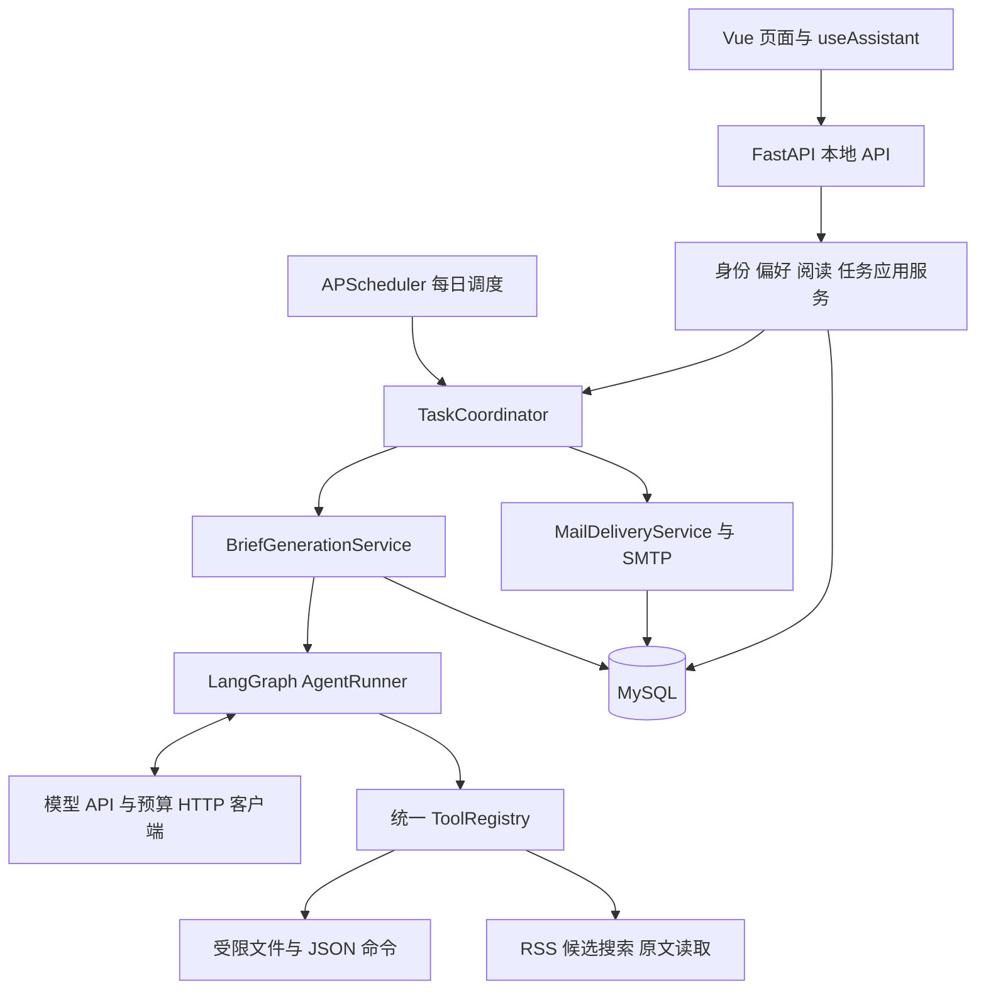
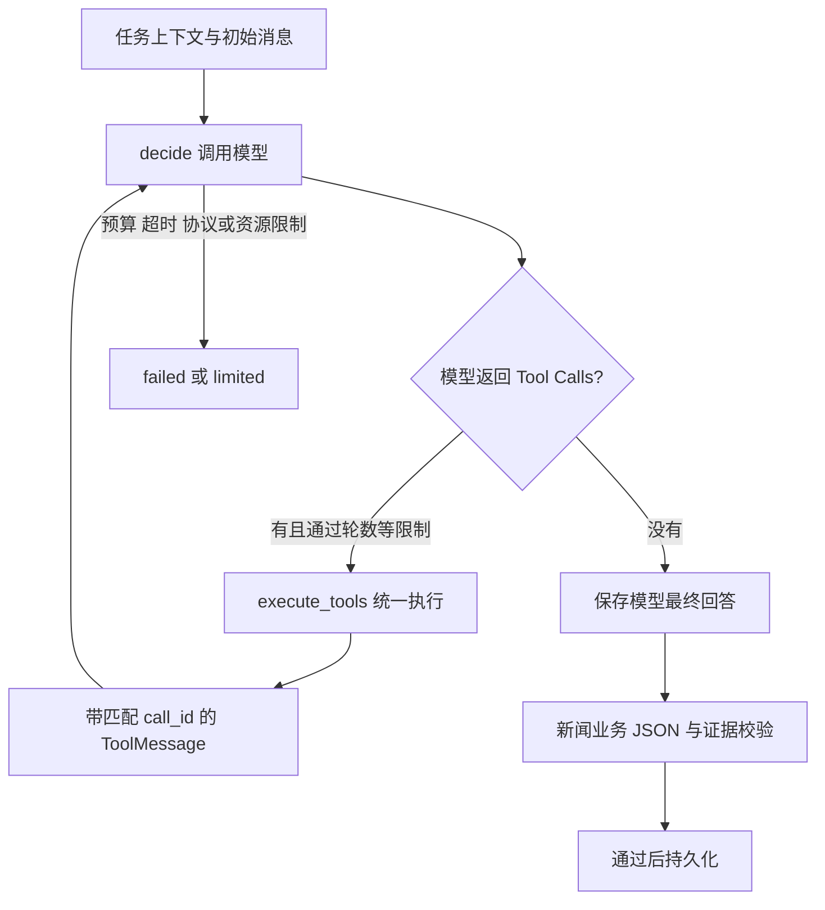

# 每日 AI 新闻助手 Agent：源码复盘

本文帮助开发者从真实实现理解项目，供代码阅读、演示和面试准备使用。核对基线为 `b29eb42` 及其之前的交付，包含累计预算控制；编写日期为 2026-11-22。证据来自当前源码、测试、数据库诊断、[完整验收报告](完整验收报告.md)和[累计预算控制](累计预算控制.md)。历史验收与本次重新执行的检查分开记录，不把设计目标当成运行结果。

配套材料：[面试讲解与问答](面试讲解与问答.md)。安装和配置以[部署与演示](部署与演示.md)为准。

## 1. 产品问题、范围和用户流程

产品针对“AI 信息来源分散，逐篇阅读耗时，订阅内容与自己的关注方向不一致”的问题。用户保存身份、话题和关键词后，系统从配置的 RSS 来源获取材料，由模型选择工具、筛选和概括，形成最多 5 条的中文简报，保留原文入口，并支持历史查询和邮件投递。

当前交付是**本机单用户 MVP**：API 固定使用本地用户，没有登录、注册、租户体系和公网服务能力。内部任务按用户快照和工作目录隔离，有内部多用户测试，但新闻缓存及收录标记等仍有共享状态，不能称为多租户产品。角色用于调整阅读语境，不是权限角色。

完整使用流程：

1. 启动 MySQL 和后端，打开页面；首次部署需要迁移数据库、构建前端，并配置模型、RSS、SMTP 和预算账本。
2. 在“身份与订阅”保存称呼、角色和本人邮箱，选择话题、关键词、排除词，以及执行时间和 IANA 时区。中国使用 `Asia/Shanghai`；时间按该时区解释。本机建议配置是每日 08:30。
3. 向已保存邮箱发送配置测试邮件，由本人实际收件后点击确认。SMTP 接受测试邮件本身不等于接收目标已验证；更换邮箱会清除验证。
4. 手动生成真实简报，或在订阅和后端调度均启用时等待每日任务。订阅关闭时仍可手动生成，此时不发新闻邮件。仅关闭调度开关并不能阻止已启用订阅的手动任务投递。
5. 后端保存任务和偏好快照，建立独立 Agent 上下文，模型开始多轮工具决策。页面查询真实任务状态，不播放虚构执行动画。
6. 模型完成后，后端校验 JSON、证据和排除词；简报、工具轨迹及投递记录落库。正常来源无合适候选时可形成空结果；来源全部失败不能伪装成“今天没有新闻”。
7. 页面查看最近简报，按日期查询历史，查看原始材料节选、来源、发布时间和原文链接。部分来源失败会提示覆盖不足；模型失败、预算限制和推送失败分别展示。
8. 非空简报符合条件时发送到已保存、已验证的邮箱。生成成功与推送成功分开记录，推送失败保留原简报，允许符合条件的有限重试。

身份和偏好保存是两个 API 请求，界面对部分成功有提示，不是整个设置表单的单事务。工具轨迹当前通过开发者 CLI 查看，用户页面不展示逐条工具内部事件，这与当前产品的阅读界面范围一致。

### 实现状态清单

“已实现”指源码及测试有证据，不代表所有真实运行条件都已覆盖。

| 能力 | 状态 | 可核实边界 |
| --- | --- | --- |
| 身份、偏好、简报、历史及状态页面 | 已实现 | 真实 API；旧 Demo 隔离在 `frontend/demo/`，测试夹具不进入生产请求 |
| 模型自主工具循环、8 个注册工具、结构化简报 | 已实现 | 模型可重复或跳过工具，业务层另外校验新闻证据 |
| 每日 Cron、手动任务、SMTP、有限重试 | 已实现 | 真实 Cron 配 Mock 服务验证；真实新闻邮件已确认收件，未长期观察每日运行 |
| 项目累计 Token 预算 | 已实现 | 数据库预留、结算、未知用量保留；不是第三方账单绝对封顶 |
| 新闻搜索 | 部分实现 | `search_news` 仅搜索当前任务 RSS 候选，没有全网搜索服务 |
| 文件和 bash 权限隔离 | 部分实现 | 路径/命令/资源限制已实现；通用低权限 OS 沙箱未完成 |
| 去重和新闻新鲜度 | 部分实现 | URL 去重与收录标记；同事件语义去重依赖模型，没有严格当天发布时间门槛 |
| 重启恢复 | 部分实现 | 持久化任务可重排队，投递不明转 unknown；不恢复到 LangGraph 中间节点 |
| RSS 增量游标 | 仅设计及接口准备 | 有游标字段/方法，生成器未消费历史游标，不是完整增量同步 |
| 开发者轨迹 HTTP 接口 | 仅设计 | 当前实际入口是 `app.diagnostics`，没有对应 HTTP 路由 |
| 公网鉴权、多租户、分布式任务队列 | 未实现 | 仅本地访问约束和单 worker 部署 |
| 通用 Shell/Windows 低权限进程沙箱 | 未实现 | 不能拿固定 JSON 命令的通过替代该项验收 |
| 精确一次邮件送达、自动送达回执 | 未实现 | SMTP 接受记 submitted；unknown 禁止盲重发 |
| 长期运行、负载容量、摘要准确率指标 | 未验证 | 没有足够样本或基准，不能给出性能、准确率和可用性承诺 |

旧[技术方案](技术方案.md)中更宽泛的 Shell、追踪接口、增量读取设想，应按上述源码状态解释；旧验收报告中的“累计硬限制未实现”已经由后续预算交付补齐。

## 2. 整体架构与模块职责



| 模块 | 实际职责和入口 |
| --- | --- |
| 前端 | [App.vue](../frontend/src/App.vue)、[useAssistant.js](../frontend/src/composables/useAssistant.js)、[api.js](../frontend/src/api.js)：初始化、保存、手动触发、轮询、接口错误；`components/` 下为简报、历史、设置与文章弹窗 |
| 服务启动 | [main.py](../backend/app/main.py)：生命周期、数据库/服务装配、路由、前端静态产物托管、调度启动与关闭 |
| API/输入输出 | [routes.py](../backend/app/api/routes.py) 与 `schemas/`：本地用户接口、请求校验、稳定错误响应；[local_request.py](../backend/app/core/local_request.py) 约束本地请求 |
| 应用层 | `application/`：profiles/preferences 保存；reading 查询；tasks 排队/恢复；briefs 校验/落库；deliveries 投递；mail_tests 收件确认；budget 累计额度 |
| Agent | [runner.py](../backend/app/agent/runner.py)：状态图和工具往返；[model.py](../backend/app/agent/model.py)：模型协议配置及任务级客户端；[budget_client.py](../backend/app/agent/budget_client.py)：模型 HTTP 前置预算检查 |
| 工具 | [registry.py](../backend/app/tools/registry.py)：Schema 与统一执行器；filesystem/commands 执行受限本地操作 |
| 新闻 | [service.py](../backend/app/news/service.py) 获取/检索/提取；[security.py](../backend/app/news/security.py) 安全 HTTP；[repository.py](../backend/app/news/repository.py) 缓存、去重、收录状态 |
| 调度/推送 | [scheduler.py](../backend/app/scheduler.py)、[deliveries.py](../backend/app/application/deliveries.py)、[smtp.py](../backend/app/delivery/smtp.py) |
| 持久化 | `models/`、`db/`、[迁移目录](../backend/migrations/versions/)：SQLAlchemy、PyMySQL、MySQL 和 Alembic |
| 开发者入口 | [diagnostics.py](../backend/app/diagnostics.py) 只读轨迹；[acceptance.py](../backend/app/acceptance.py) 受控验收；[budget.py](../backend/app/budget.py) 本地预算管理 |

前端使用 Vue 3、Vite、JavaScript；后端使用 FastAPI/Pydantic、LangChain Core/OpenAI 适配与 LangGraph。LangGraph 负责状态转换，**不是凭框架名称就具备自主性**；自主性由模型 Tool Calls 与执行节点的数据依赖建立。没有 Redis、向量数据库、消息队列或 Kubernetes。

开发时 Vite 代理 `/api` 到后端；构建后 `frontend/dist` 由后端同源托管。当前部署要求单 Uvicorn worker；本机部署已经有文档和运行证据，没有线上生产部署证据。

## 3. Agent 核心循环：沿代码读一遍

主要入口是 `AgentRunner`。业务层传入任务提示、工具上下文和限制，而不是把 `fetch_rss → search_news → fetch_article` 写成固定工作流。



1. **公布能力。** `__init__` 执行 `model.bind_tools(registry.model_schemas(), tool_choice="auto")`。Schema 来自注册表，默认有五个本地工具和三个新闻工具。`_task_system_prompt` 只列启用的来源 ID、名称和分类，不给模型服务密钥或推送目标。
2. **提供本次任务。** `BriefGenerationService` 的 `_build_task` 放入报告日期、称呼/角色、话题、关键词、排除词、输出格式与目标条数。每个任务有独立 `ToolContext`、消息列表和候选集合。
3. **模型决策。** LangGraph `decide` 调用模型，读取 `AIMessage.tool_calls` 和无效调用信息。`pending_calls` 来源是本轮模型响应；名称、参数、顺序、重复次数都不由业务代码拼成计划。
4. **安全执行。** `execute_tools` 遍历本轮请求，经统一注册表校验参数并执行。一个模型响应可以包含多个调用，当前按顺序执行，并未并行执行。包含 `write_file` 或 `bash` 的多调用批次整体拒绝，返回 `unsafe_parallel_batch`。
5. **回传观察。** 每个结果序列化为 `ToolMessage`，`tool_call_id` 与模型调用 ID 对应，追加到消息历史，模型可据此修改选择、重复读取、处理错误或结束。未知工具和不合规参数返回机器可读错误，不静默替换成另一个工具。
6. **正常结束与强制结束。** 没有 Tool Calls 的模型回答是正常结束。默认限制包括单模型请求 45 秒、任务 300 秒、8 轮工具、每轮 8 次调用，以及单次输入 128,000/任务累计 512,000 序列化字节；预算另有累计拦截。超限记 limited 或 failed，不能包装成正常简报。
7. **业务复核。** 通用 Agent 可以零工具回答，但新闻服务不会因此保存无证据新闻。最终回答必须满足 `BriefDraft`、引用当前任务候选且有材料，才能落库。

这是 Function Calling 实现的“行动—观察—再决策”循环，可称为 ReAct 风格；没有解析自由文本 Thought/Action，也不保存或对外输出模型私有思维过程。任务轨迹记录的是可观察决策和执行结果。

### 怎样证明它不是固定流程

[test_runner.py](../backend/tests/agent/test_runner.py) 是首要证据：

- `test_different_model_tool_calls_produce_different_traces`：同一执行器在不同 Mock 模型响应下得到不同轨迹。
- `test_model_can_repeat_a_tool_and_decide_when_to_stop`：重复和结束来自模型响应。
- `test_tool_result_is_returned_with_matching_call_id`：确认模型确实收到对应执行结果。
- `test_final_answer_without_tool_calls_completes_immediately`：通用循环不强制先执行工具。
- 错误恢复、批次限制和轮数限制测试证明保护机制不会偷偷补执行预设步骤。

[test_briefs.py](../backend/tests/application/test_briefs.py) 的 `test_model_decisions_drive_different_brief_traces_and_persist_evidence` 使用有脚本的 `PreferenceAwareModel` 测试替身，验证不同偏好/决策能产生不同工具路径和落库结果。它证明程序契约，不能证明真实模型偏好匹配的准确率。

真实验收还保存了模型决策与执行轨迹，见第 9 节。真实路径的调用次数不同是辅助证据，严格证明仍要结合上述 Mock 断言和 `pending_calls` 的源码来源。

## 4. 五个必需工具：参数、实现、安全

五个均在 `create_default_registry` 注册并进入模型工具列表。[schemas.py](../backend/app/tools/schemas.py) 使用 Pydantic，禁止额外字段。执行失败通过 `ToolResult` 返回错误码；返回模型的工具 JSON 最大 12 KiB，过大内容有截断提示。

“注册可调用”不等于每次新闻任务都会使用。当前任务编排只创建 `inputs/`、`history/`、`drafts/`，没有自动把数据库偏好与历史批量导出为这些目录的材料。真实新闻主要经新闻工具与数据库流转，五个本地工具的读写能力由独立测试材料验证；不能说 Agent 每次都搜索了历史文件或必须写文件才能保存简报。

| 工具及参数 | 真实实现位置 | 用途与限制 |
| --- | --- | --- |
| `list_dir(path="")`，path 最长 300 字符 | [filesystem.py](../backend/app/tools/filesystem.py) `list_directory` | 列出任务工作区可见条目，根目录允许列出；返回最多 100 项，扫描最多 500 项，过滤受限条目 |
| `read_file(path)`，1–300 字符 | 同文件 `read_text_file` | 读取 `inputs/`、`history/` 的允许文本类型；UTF-8、最多 64 KiB，不能任意读取服务器文件 |
| `search_content(keyword, dir)`，关键词 1–200、目录 1–300 字符 | 同文件 `search_text` | 本地字面、大小写不敏感匹配；仅材料目录。深度 8、文件/目录各 200、扫描总量 4 MiB、结果 50、节选 240 字符、扫描时间检查 2 秒 |
| `write_file(path, content)`，path 1–300，content 最多 65,536 字符且有字节限制 | 同文件 `write_draft` | 只写 `drafts/` 内 txt/md/json、最多 64 KiB；临时文件、fsync、原子替换。写草稿不等于修改数据库偏好或保存正式简报 |
| `bash(command)`，1–500 字符 | [commands.py](../backend/app/tools/commands.py) `run_restricted_command` | 真实启动子进程，但只支持 `python -m json.tool inputs/或history/下的JSON文件`；不是任意命令执行工具 |

路径检查拒绝绝对路径、盘符、`..`、ADS 冒号、隐藏/敏感文件名，以及符号链接、Junction/重解析点和硬链接等危险入口。读写还检查目录、文件类型和大小，工具上下文绑定本次任务工作区，不能把模型提供的路径直接交给系统。

`bash` 把模型命令解析成有限语法，拒绝其他程序、额外参数、管道、重定向、命令串和元字符。它先安全读取 JSON 快照并校验深度，实际子进程固定为当前解释器的 `-I -S -m json.tool`，使用 stdin 传材料，`shell=False`，工作目录固定，环境最小化；2 秒超时后终止并回收，输出最多 4 KiB，输入最多 64 KiB、JSON 深度最多 32。

这些措施显著缩小了执行面，但**没有通用 Windows 低权限进程沙箱**，工作区 ACL 不由代码完整强制设置，同一系统用户并发替换文件的竞态未被完全隔离。不能说“已经安全支持任意 Bash”。测试见 [test_registry.py](../backend/tests/tools/test_registry.py)、[test_filesystem.py](../backend/tests/tools/test_filesystem.py)、[test_commands.py](../backend/tests/tools/test_commands.py)。

## 5. 新闻获取、搜索和来源追溯

另有三个真实注册工具，参数沿用统一 Schema/执行器：

| 工具 | 参数 | 实际行为 |
| --- | --- | --- |
| `fetch_rss` | `source_ids`：1–5 个唯一来源 ID，每个最长 64 字符 | 仅访问预配置、启用来源；模型不能传任意 feed URL。每个 feed 只处理有限窗口，最多前 50 项；候选摘要输出有数量限制 |
| `search_news` | `query`：1–200 字符；`limit`：1–20，默认 10 | 只检索本次任务已获取候选的标题、摘要、来源、分类及已读原文。空白拆词后全部匹配；不接入全网搜索 API、向量检索或学习排序 |
| `fetch_article` | `article_id`：16–64 字符 | 只读当前候选 ID 对应的已允许来源；提取正文，最多 24,000 字符，分块回传，可重复调用读取后续内容 |

实现见 [NewsService](../backend/app/news/service.py)、[新闻 Schema](../backend/app/news/schemas.py) 和[配置加载](../backend/app/news/config.py)。示例源包括 OpenAI `https://openai.com/news/rss.xml`、Google DeepMind `https://deepmind.google/blog/rss.xml`、Microsoft Research `https://www.microsoft.com/en-us/research/feed/`；以本地实际启用配置为准。RSS 不需要付费搜索账号，但来源可能失效、限流、超时或更换结构。

网络安全入口只允许已配置来源/域名和标准端口；禁止私网等非公网 IP，DNS 校验后连接固定到已验证地址，保留 Host/TLS SNI 与证书检查；每次重定向重新校验。HTTP 有 2 MiB 内容限制、最多 3 次跳转、总时限检查和连接/读取超时，不使用环境代理。它用于防 SSRF，不是允许模型自由浏览互联网。

来源追溯链为：RSS 条目 → 规范化 URL/哈希 → `NewsArticle` 候选 → 模型引用 `article_id` → 服务端 `_hydrate_items` 填充来源字段 → 简报快照。URL 去除已知追踪参数和 fragment，保留有意义的 query；哈希用于稳定 ID 与精确去重，不代表语义去重。

每条结果保留标题、来源名/ID、原文 URL、canonical URL、发布时间原值、可解析 UTC、字段来源和抓取时间。缺乏明确时区的日期不会伪造 UTC；published 缺失时可使用 updated 并保留该字段来源。页面区分模型概括与原始材料节选。

正文用 HTMLParser 提取并去掉脚本等标签，不是专用浏览器排版提取器，仍可能带导航噪声。已有 RSS 摘要或缓存正文足够时，不强制调用 `fetch_article`。有限窗口、URL 去重、共享收录标记和无硬性新鲜度门槛意味着不能保证“今天全网最全最新”，也不能声称完整增量同步。

## 6. 用户偏好如何产生影响

偏好来源是数据库中的订阅配置，执行时转为快照。`_build_task` 把话题、关键词、排除词和身份语境交给模型，提示模型自主选择源、是否搜索候选、是否进一步读取，以及最终选哪些条目：

- 话题是相关性方向，关键词用于提高优先级，不是每条新闻必须命中的硬过滤条件。
- 模型生成中文 `summary` 和 `relevance_reason`，后者解释与偏好的关联；没有训练推荐模型或离线相关性指标。
- 排除词有代码级兜底：对原始标题、原始摘要和生成摘要做 casefold 字面检查。任一命中使整份简报校验失败，不是悄悄删除该条后宣称正常完成。
- 输出最多 5 条、article_id 不重复，空结果需要理由。服务端核实 ID 属于当前候选且被工具标记为已呈现，来源启用且有材料，原文地址合规；标题、来源和日期由材料填充，避免模型自行编造这些字段。

这是“提示约束 + 结构化输出 + 硬校验”的组合。来源正确不等于每句摘要完全正确；内容仍可能误解材料、遗漏偏好。当前“已呈现 ID”在最终工具消息截断前记录，也不等于能证明模型完整读过全部材料。不要将证据绑定说成事实准确率保证。

## 7. 定时、持久化、投递与预算

### 任务生命周期

[TaskCoordinator](../backend/app/application/tasks.py) 是手动与每日任务的共同入口。用户行锁、幂等键和状态条件更新防止重复领取；当前用户有活动任务时不新开另一个，普通同日报告已 completed/empty 时复用，而不是重复消费模型。手动请求可带 `Idempotency-Key`，每日使用用户与日期生成键。失败重试允许新尝试；有待投递/投递不明记录时限制普通重新生成。

任务先保存 queued，再由后台执行并条件领取为 running，保留时间、状态、失败码和尝试次数。偏好快照在排队时持久化，身份的称呼/角色在生成开始时读取，并不存成完整身份快照。不同 run_id 使用独立工作目录，每次执行创建新的内存上下文；同一 run_id 的恢复沿用原目录。FastAPI BackgroundTasks 是进程内执行机制，不是持久化队列；持久性来自数据库任务记录和恢复逻辑。

`task_run.started_at` 默认在记录创建时写入，排队领取时没有重新设置；因此它也包含排队起点的含义，不能用它精确分离排队等待和模型执行耗时。尝试次数与工具耗时可查，但没有逐尝试完整时间表。这是当前观测粒度的不足。

APScheduler 使用订阅时区及时间创建 Cron，加载启用且目标已验证、SMTP 条件满足的订阅；刷新任务配置和扫描重试分别有周期任务。MySQL `GET_LOCK` 约束调度领导者，部署仍要求单 worker，不是多节点高可用系统。

重启时当天 queued/running 可恢复，running 重排队后从新 Agent 尝试开始；保留旧尝试轨迹。跨日遗留任务和调度关闭等情况有失败处理。没有 LangGraph 持久化 Checkpointer，也没有恢复到同一次模型调用后的精确节点。SMTP 处于 sending 的遗留记录转 unknown，防止重启后盲重发。

### 简报与邮件的边界

通过校验后，简报、任务完成数据、工具记录、新闻收录标记和邮件待投递记录在业务事务中保存。失败不会把未完成回答当正式简报。邮件在保存后由独立服务处理，SMTP 失败不回滚已保存新闻。

目标来自已保存并验证的配置，模型不获得收件地址，也不能调用邮件工具。生成落库时载入目标，投递领取时再次确认当前目标、验证和启用状态；目标变化不会向旧目标继续投递。投递行有幂等键、行锁、条件领取及尝试次数。

SMTP 接受后记 `submitted`，不冒充已送达。临时失败有限指数退避（默认最多 3 次自动尝试），永久失败记 failed；允许的人工重试另有次数上限。DATA 阶段超时/断线可能已经被服务商接收，记 unknown，不自动或人工盲重发。确定 Message-ID 辅助追踪，不代表服务商承诺去重。数据库事务不能与外部 SMTP 原子提交，因此没有跨系统“精确一次送达”保证。

### 累计预算

[BudgetHTTPClient](../backend/app/agent/budget_client.py) 在模型 HTTP 层实施项目总额限制，覆盖业务 Agent 和直接创建模型的真实测试。项目共用 100 万输入加输出 Token；每次请求先用请求 JSON 字节、最大输出和附加安全量估算保守预留，数据库原子扣留，收到真实 usage 后结算。超时、缺失用量和崩溃预留保持待核对，不自动退款；数据库不可用时拒绝请求。

已知历史用量和用户同意的 200,000 安全预留均已初始化。编写时快照为已确认 145,552、历史待核对 200,000、请求中预留 0、可用 654,448；运行后应以账本为准。安全预留不等于真实账单，UTF-8 字节也不是精确分词。供应商隐藏用量、忽略限制等不受本地完全控制，所以不能承诺账单绝对不超支。

## 8. 关键数据表和 API

当前为 **10 张业务表**，另有 Alembic 迁移版本表。模型是事实来源，见 [models](../backend/app/models/)；表名和关键约束如下。

| 表 | 职责与关联 |
| --- | --- |
| `user_profile` | 本地身份、邮箱和验证状态；任务排队时作为用户级锁入口 |
| `subscription_preferences` | 用户话题、关键词、排除词、启用、时间和时区 |
| `rss_source` | 来源配置状态及抓取信息；存在游标相关准备字段 |
| `news_item` | URL/article_id 唯一、来源材料、抓取与收录状态；不是独立向量索引 |
| `task_run` | 用户、触发类型、日期、偏好快照、状态、时间、用量、模型决策摘要；幂等键唯一 |
| `brief` | 正式简报内容及来源快照，`run_id` 唯一 |
| `tool_call` | run、attempt、call_id、轮次、工具、脱敏参数摘要、结果/错误及耗时；三元组合唯一 |
| `mail_delivery` | 简报关联、固定接收目标、状态、尝试和服务信息；brief/幂等键约束防重复记录 |
| `token_budget` | 项目累计上限、已确认、未知/预留和阻断状态 |
| `token_usage` | 每个模型请求的预留/结算数字流水，不存原始 prompt、响应正文或密钥 |

API 前缀为 `/api/v1`，实现在 [routes.py](../backend/app/api/routes.py)：

| 方法与路径 | 使用方式 |
| --- | --- |
| `GET/PUT /profile`、`GET/PUT /preferences` | 读取/保存本地身份与订阅，Pydantic 校验 |
| `POST /runs` | 空 JSON `{}` 发起手动任务，返回 202；可带幂等键 |
| `GET /runs/{run_id}`、`GET /status` | 单次任务与工作区状态，前端据此轮询 |
| `GET /briefs/latest`、`GET /briefs/{brief_id}` | 最新或指定简报，最新可以为空 |
| `GET /history` | 日期 report_date、offset、limit 分页，limit 上限 100 |
| `GET /mail/status` | SMTP 就绪/邮箱验证等安全状态，不返回 SMTP 密码 |
| `POST /mail/test`、`POST /mail/test/confirm` | 向已保存目标测试、本人确认收件；不是由模型修改目标 |
| `POST /briefs/{brief_id}/delivery/retry` | 对允许失败状态重试原简报，不重新调用模型 |
| `GET /budget`、`GET /health` | 额度安全摘要和服务健康；没有公开预算写接口 |

前端在活动任务/投递期间较频繁轮询，其他时候较低频轮询；浏览器不保存模型密钥。读取逻辑限定本地用户拥有的数据。但 API 没有身份认证，不适合仅靠改绑定地址就对外开放。

## 9. 异常、安全与测试证据

### 安全措施与剩余风险

| 场景 | 当前措施 | 不能夸大的部分 |
| --- | --- | --- |
| 文件越界/命令注入 | 相对路径/类型/链接检查、固定 argv、shell=False、读写与执行限额 | 无通用 OS 沙箱；同用户竞态并未完全解决 |
| SSRF/DNS 变更 | 已配置来源、域名白名单、公网 IP 校验、固定连接 IP、逐跳校验 | 来源允许范围需要人工维护；不是任意 URL 抓取 |
| 网页提示注入 | 外部内容按不可信材料提示；工具执行权限独立硬限制，输出绑定候选证据 | 无法保证模型完全不受恶意文本影响，摘要事实仍需复核 |
| 未授权访问 | 绑定 localhost、本地 Host/Origin 及修改请求 JSON 约束、固定用户和归属检查 | localhost 来源检查允许本地端口，不是登录鉴权；本机恶意进程不在可靠隔离范围 |
| 秘密与日志 | `.env`/实际来源配置忽略，前端不接密钥，轨迹只存参数类型/长度、错误码和结果字段摘要 | 脱敏降低泄露面，不等于系统已做全套安全审计 |
| 无限循环/资源占用 | 工具、输入/输出、轮数、时间、HTTP 和预算限额 | 取消外层异步任务不保证所有底层 I/O 或外部副作用立即消失 |
| 重复任务/推送 | 唯一键、事务行锁、条件领取、unknown 保留不重发 | 非跨数据库/SMTP 的 exactly-once，不具备分布式高可用证明 |

工具错误回传模型，模型请求超时、总时限、预算不足与 JSON 校验失败分别记录；部分新闻来源失败形成覆盖提示。无新闻、Agent 失败、推送失败是不同状态，不混成“成功但没有内容”。

### 测试如何分层

| 层级 | 代表证据 | 验证目的 |
| --- | --- | --- |
| 工具 | `tests/tools/` | 注册/Schema、路径穿越、Junction/硬链接、读写限额和固定命令 |
| Agent 单元 | `tests/agent/test_runner.py` | 不同模型决策→不同轨迹，重复/停止、回传 ID、错误恢复、限制、脱敏 |
| 协议契约 | [test_model_protocols.py](../backend/tests/agent/test_model_protocols.py) | 两种模型协议的 HTTP 请求/工具结果、8 个 Schema、输出限制及客户端生命周期 |
| 新闻 | [test_news_tools.py](../backend/tests/news/test_news_tools.py)、[test_repository.py](../backend/tests/news/test_repository.py) | RSS/正文、去重、来源字段、SSRF/跳转、缓存与失败 |
| 应用链路 | `tests/application/` | 偏好到简报落库、空结果、非法证据、事务回滚、用户快照隔离、恢复、投递与人工确认 |
| 调度/SMTP | [test_scheduler.py](../backend/tests/test_scheduler.py)、[test_tasks.py](../backend/tests/application/test_tasks.py)、[test_smtp.py](../backend/tests/delivery/test_smtp.py) | 实际 Cron 配 Mock 服务、停用不推送、SMTP 超时阶段分类、有限重试、防重复 |
| 实库并发 | [test_mysql_acceptance.py](../backend/tests/integration/test_mysql_acceptance.py)、[test_mysql_budget.py](../backend/tests/integration/test_mysql_budget.py) | 8 路并发排队/领取/重试与额度预留的唯一胜者，不是吞吐量压测 |
| 预算 | [test_budget.py](../backend/tests/test_budget.py) | 结算幂等、未知保留、预算中途耗尽、DB 失败拒绝发请求等 |
| 前端 | [测试目录](../frontend/src/__tests__/) | 表单/页面、真实 API 契约、网络/空/错误/预算状态，另保留隔离 Demo 测试 |

**本次文档整理重新运行**：后端默认测试 158 passed、9 skipped；其中 8 项需要显式启用真实服务（模型 2、RSS 1、MySQL 5），1 项缺少 Windows 符号链接权限。前端 41 项通过，生产构建通过。默认测试不发真实邮件、不消费真实模型。跳过真实测试不是表示对应服务已经再次验证。

**历史完整验收证据**：预算交付时后端 166 passed、1 skipped，显式启用真实模型/RSS/MySQL；前端 41 passed。跳过项为 Windows 创建符号链接权限不足（WinError 1314），不是人为隐藏失败；Junction 与硬链接实际测试通过。本机报告在 Git 忽略的 `backend/data/budget-acceptance-tests.xml`，不是仓库自带可复现结果。

两条实际模型轨迹可用只读 CLI 查询：

| 运行 | 观察结果 |
| --- | --- |
| G：`079ce755-72ec-4c92-bbfb-36e5b86424e1` | completed、brief 1；4 次模型返回、3 轮工具；fetch_rss → 5 次 fetch_article → 2 次 fetch_article；共 33,246 Token |
| 完整验收：`acceptance-b979912c-6efd-4e31-8df7-e57cd8872e29` | completed、brief 3；4 次模型返回、3 轮工具；fetch_rss → 5 次 fetch_article → 3 次 fetch_article；4 条新闻，32,196 Token |

第二条在部分来源/正文读取异常下仍有可用材料；保存后 SMTP 仅一次尝试，状态 submitted。用户明确确认收到该封 4 条新闻简报，是此次真实收件证据；不代表配置了自动送达回执。后续预算交付的两项真实模型测试共 5 次 HTTP 请求、26,781 Token，不与该简报的用量混算。

```powershell
# 在 backend 下，只读查看现有轨迹，不产生模型请求或邮件
uv run --locked python -m app.diagnostics acceptance-b979912c-6efd-4e31-8df7-e57cd8872e29

# 离线验证模型决策契约，不需要真实 API Key
uv run --locked pytest tests/agent/test_runner.py -q
```

真实每日 Cron 尚未跨多天连续观察；已有真实链路来自受控一次性触发，Cron 本身通过 Mock 外部服务验证。当前每日订阅和调度均停用，本文不会开启它们。

## 10. 技术取舍、复盘和迭代

| 当前取舍 | 原因与成本 | 合理的下一步，不代表已实现 |
| --- | --- | --- |
| 受控 RSS 替代全网搜索 | 来源可追溯、无需搜索付费账号，代价是覆盖有限 | 增加合规搜索供应商、游标消费与新鲜度策略，保留统一证据模型 |
| 手写图节点与统一工具执行器 | 决策和权限边界清楚、容易用 Mock 验证，需自己维护协议及资源限制 | 增加模型兼容性契约和结构化质量评测，不为复杂而叠框架 |
| 本机单用户/单 worker | 缩小 MVP 复杂度，牺牲公网部署与扩展能力 | 公网化前补认证、授权、租户隔离、HTTPS、持久任务队列和运维观测 |
| JSON 命令代替任意 Shell | 保留真实子进程示例并降低风险，通用命令能力受限 | 只有有业务必要时才增加 OS 低权限/容器沙箱及竞态测试 |
| 简报先保存再发送 | 推送故障不会丢内容，外部提交仍有不确定窗口 | 加人工核对与服务商回执；不能靠自动重试解决所有 unknown |
| 任务恢复重跑而非图断点续跑 | 实现简单、历史轨迹保留，可能重复模型/只读工具成本 | 引入持久化 Checkpointer 前定义工具副作用幂等与恢复语义 |
| 预算保守预留 | 不把超时视为免费，可能提前拒绝实际可负担请求 | 核对历史账单、改进估算，保留供应商侧独立额度限制 |
| URL 去重与模型语义判断 | 成本低，不能稳定识别所有同事件报道 | 构造标注样本，再评估语义去重与摘要事实检查的收益 |

最重要的工程认识是：模型可以决定行动，但程序必须决定权限、资源和成功条件。这个项目有真实自主循环和真实收件证据；它仍是有条件验收的本地 MVP，不是已证明高并发、高准确率或长期无人值守的生产系统。

### 建议阅读与演示顺序

先读产品流程，再沿 `routes.create_manual_run → TaskCoordinator → BriefGenerationService → AgentRunner → ToolRegistry` 看一次真实任务；接着读 `_hydrate_items` 和邮件领取，最后看 Mock 测试及已保存诊断。面试演示优先使用现有简报和只读轨迹，再运行离线决策测试。需要新增真实运行时，先检查额度及收件配置，生成与真实发送分别控制，避免为展示重复投递。

### 本次检查记录

本次仅新增复盘文档并增加 README 入口，没有修改运行代码、配置或业务数据。

- 后端：`uv run --locked pytest -q`，158 passed、9 skipped，未启用真实服务测试。
- 前端：`npm test`，41 passed；`npm run build` 通过。
- 文档：README 和两份新文档的相对链接均可解析到实际文件/目录，代码围栏配对，问答数量为 10；核对引用测试名称与源码模块。
- Git：提交前检查工作区、差异及暂存区，仅提交上述三个文档文件；已有未跟踪的分阶段提示词不纳入交付。
